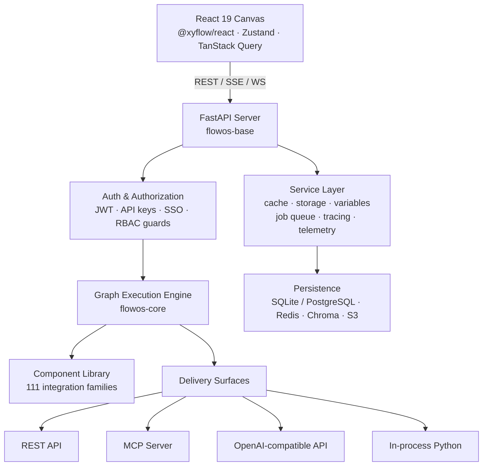

# FlowOS — The Operating System for AI Workflows

### Major Project Report · B.E. Final Year

| | |
| --- | --- |
| **Project title** | FlowOS — A Visual, Governed, Zero-Rewrite Platform for Building and Deploying AI Agent Workflows |
| **Student** | Dhadi Sai Praneeth Reddy |
| **Roll number** | 1602-23-733-038 |
| **Institution** | Vasavi College of Engineering, Hyderabad |
| **Organization** | Atlas AI Labs |
| **Domain / Area** | Artificial Intelligence · Large Language Model Orchestration · Full-Stack Systems Engineering · MLOps / LLMOps |
| **Version** | 0.1.1 |
| **License** | MIT |
| **Repository** | https://github.com/dspraneeth07/FlowOS |
| **Documentation** | https://docs.flowos.org |
| **Distribution** | `uv pip install flowos` (PyPI) · `flowosai/flowos` (Docker) · `FlowOS.exe` (Windows launcher) |

---

## Table of Contents

1. [Abstract](#1-abstract)
2. [Introduction](#2-introduction)
3. [Literature Survey and Existing Systems](#3-literature-survey-and-existing-systems)
4. [Problem Statement](#4-problem-statement)
5. [Core Problems and the Solutions We Built](#5-core-problems-and-the-solutions-we-built)
6. [Objectives and Scope](#6-objectives-and-scope)
7. [Unique Selling Proposition](#7-unique-selling-proposition)
8. [How FlowOS Is Different From Existing Solutions](#8-how-flowos-is-different-from-existing-solutions)
9. [System Architecture](#9-system-architecture)
10. [Feature Catalogue](#10-feature-catalogue)
11. [Technology Stack](#11-technology-stack)
12. [Methodology](#12-methodology)
13. [Implementation Details](#13-implementation-details)
14. [Testing and Validation Strategy](#14-testing-and-validation-strategy)
15. [Results and Outcomes](#15-results-and-outcomes)
16. [Limitations](#16-limitations)
17. [Future Scope](#17-future-scope)
18. [Conclusion](#18-conclusion)
19. [References](#19-references)

---

## 1. Abstract

Large Language Models have made it trivial to build an *impressive demo* and remarkably difficult to build a *dependable product*. A notebook that chains a retriever, a prompt and a model can be assembled in an afternoon; converting that same logic into a governed, observable, versioned, multi-user service typically consumes weeks of engineering and, worse, forces a full rewrite in which the validated logic silently drifts from the shipped logic.

**FlowOS** is a full-stack platform that removes that gap. It is a visual workflow builder for AI agents in which the flow the user designs on a canvas *is itself* the deployable production artifact. A flow authored by dragging nodes onto a React canvas can, without any translation or code generation step, be served simultaneously as a REST API, as a Model Context Protocol (MCP) server, as an OpenAI-compatible `/responses` endpoint, and as an in-process Python call executed by a stateless, database-free executor.

The system is organised as a seven-package monorepo: a FastAPI/Python backend (`flowos-base`), a React 19 + TypeScript canvas, a lightweight stateless execution engine (`flowos-core`) that can run flows in serverless and CI environments with no database, a Python SDK, a Stepflow execution backend, and optional integration bundles. It ships **111 integration families** covering LLM providers, vector stores, retrieval tooling and observability platforms, exposed through **400+ uniform component modules** and **33 starter templates**.

Two capabilities distinguish FlowOS from comparable open-source builders. First, **no ceiling**: every visual component exposes its live Python source for in-app editing, so the canvas is a view over real code rather than a walled garden that developers must abandon when requirements outgrow the node palette. Second, **governance as a first-class, fail-closed concern**: a pluggable Role-Based Access Control layer evaluates every sensitive operation as a `(subject, domain, object, action)` four-tuple, writes a queryable audit record for each decision, and is architected so that enabling the feature flag *without* a registered enforcement plugin can never widen visibility. Flow versioning with one-call activation and rollback closes the loop, making a bad prompt change recoverable rather than catastrophic.

The result is a working, installable, MIT-licensed platform of ~2,700 Python modules and ~1,800 TypeScript modules, validated by 552 backend test modules, 380 frontend unit test files and 166 Playwright end-to-end specifications, delivered as PyPI wheels, multi-image Docker builds, a Docker Compose observability stack, and an 11 MB Windows desktop bootstrapper that requires no pre-installed Python runtime.

---

## 2. Introduction

### 2.1 Context

Between 2023 and 2026 the dominant mode of building software with AI shifted from *training a model* to *orchestrating models*. The scarce engineering skill is no longer gradient descent; it is composing retrievers, tools, memory stores, routers and guardrails into a reliable pipeline, and then operating that pipeline safely for real users.

This shift created a new category of tooling — the *AI workflow builder*. Tools such as Langflow, Flowise, Dify and n8n let a developer wire an agent together on a canvas. They are excellent for demonstration and prototyping. In production settings, however, three failure modes recur with near-perfect consistency:

1. The prototype cannot become the product without being rebuilt.
2. The visual abstraction runs out of expressiveness and there is no escape hatch.
3. The tool has exactly one trust level — full access — making it unusable in any organisation where "who may run this agent, and what did it do?" is a question that must be answerable.

### 2.2 Motivation

FlowOS was motivated by the observation that these three failures are not independent. They are all consequences of a single architectural decision: treating the canvas as an *authoring surface* that produces a configuration, rather than as a *projection* of a real, executable, governable artifact.

If the flow graph is the runtime artifact — not a specification that some other system interprets — then the rewrite disappears, the escape hatch becomes trivial (open the node's source, it is real Python), and governance can be enforced uniformly at the graph boundary rather than bolted on per-integration.

FlowOS is the implementation of that thesis.

### 2.3 Relationship to prior work

FlowOS is built on the open-source Langflow project (MIT) and stands on the LangChain, FastAPI and React Flow ecosystems. It is a governance-first, production-hardened evolution of that architecture. The substantive engineering contributions layered on top are documented in §5 and §8 and include: asymmetric RS256/RS512 JWT signing with auto-provisioned key material, an independently-toggleable audit mode, a cross-user resource-sharing CRUD API with an owner-or-superuser security floor, a deployment provider registry with snapshot and drift detection, project-scoped MCP servers, and a clean separation of the stateless executor (`flowos-core`) from the stateful platform. Attribution is recorded in the project README and LICENSE.

---

## 3. Literature Survey and Existing Systems

| System | Category | Strengths | Limitations observed |
| --- | --- | --- | --- |
| **LangChain / LangGraph** | Python library | Maximum expressiveness; strong graph execution semantics; large ecosystem | Code-only — no canvas, no server, no auth, no persistence, no UI. Every team rebuilds the same platform around it. |
| **Langflow** | Visual builder | Mature canvas; deep Python extensibility; MIT licensed | RBAC and audit are enterprise/paid concerns; symmetric JWT only; executor and platform not cleanly separable. |
| **Flowise** | Visual builder | Fast to start; large node library | Limited custom-code extensibility; no RBAC or audit; no stateless executor; commercial licence terms on parts. |
| **Dify** | LLM app platform | Strong packaged end-user chat applications; good RAG UX | Less developer control over custom code; governance behind paid tier; modified open-source licence. |
| **n8n** | General automation | 400+ SaaS integrations; excellent scheduling and triggers | General-purpose automation, not LLM-native; agents, RAG and model routing are second-class; fair-code licence. |
| **Managed clouds** (vendor agent builders) | SaaS | Zero operations burden | Vendor lock-in; data residency constraints; no self-hosting; opaque cost model. |

**Gap identified.** No surveyed system simultaneously provides (a) a visual canvas with an unrestricted code escape hatch, (b) a single artifact addressable through four independent runtimes, (c) a database-free stateless executor for serverless and CI, and (d) pluggable, fail-closed RBAC with a queryable audit trail — under a permissive licence, in the open-source edition. FlowOS occupies that gap.

---

## 4. Problem Statement

> **Design and implement a self-hostable, permissively-licensed platform in which an AI agent workflow authored on a visual canvas becomes — with no rewrite, code generation step, or translation layer — a governed, versioned, observable production service simultaneously addressable as a REST API, an MCP server, an OpenAI-compatible endpoint and an embeddable in-process library call; such that the visual abstraction never blocks the developer, every privileged operation is authorised and auditable, and any change to a live flow is reversible.**

The statement decomposes into six verifiable requirements:

| R# | Requirement | Acceptance criterion |
| --- | --- | --- |
| R1 | Zero-rewrite deployment | The persisted flow record is the executed artifact; no build/transpile step separates design from run. |
| R2 | No abstraction ceiling | Any component's Python source is viewable and editable from within the UI, and the edited source executes. |
| R3 | Provider neutrality | Swapping LLM, embedding model or vector store requires a configuration change, not a code change at call sites. |
| R4 | Batteries included | Auth, sessions, streaming, ingestion, chunking, retrieval, secrets, tracing and rate limiting ship in the platform. |
| R5 | Governable | Every sensitive route is guarded by an authorisation check that is enforceable, pluggable, and audited. |
| R6 | Reversible | Any flow can be snapshotted, listed, activated and rolled back through an API. |

---

## 5. Core Problems and the Solutions We Built

### Problem 1 — The prototype-to-production rewrite

**The problem.** A validated notebook or canvas demo must be reimplemented as a service before it can be shipped. The rewrite costs weeks and, more damagingly, introduces *semantic drift*: the deployed logic is no longer exactly what was evaluated, so evaluation results stop being evidence.

**Our solution — one artifact, four runtimes.** The saved flow graph is the deployable artifact. FlowOS mounts it on four independent delivery surfaces without any intermediate representation:

| Surface | Endpoint / entry point | Consumer |
| --- | --- | --- |
| REST | `POST /api/v1/run/{flow_id_or_name}` with generated OpenAPI schema | Any HTTP client |
| MCP server | `flowos-mcp`, plus project-scoped MCP servers | Claude, Cursor, any MCP client |
| OpenAI-compatible | Responses API (`openai_responses` router) | Existing OpenAI SDK applications, via base-URL change only |
| In-process | `flowos_core` executes exported flow JSON | Python applications, CI pipelines, serverless functions |

Because all four read the same graph record, there is no drift by construction.

### Problem 2 — Visual tools are dead ends

**The problem.** No-code builders trap users. The moment a requirement escapes the node palette — a bespoke ranking heuristic, an unusual auth handshake, a proprietary parser — there is no exit, and the team restarts in code, discarding the visual work.

**Our solution — an escape hatch at every node.** Each component's Python source is rendered in an in-app Ace editor with syntax highlighting and is editable in place. The canvas is a *view over real code*. A custom-component framework with typed `Input`/`Output` declarations lets new components be authored from scratch, and `FLOWOS_DEV=1` hot-loads them without a server restart (`FLOWOS_DEV=openai,mistral` narrows loading to selected modules to keep startup fast during development). Component bundles can additionally be installed into a *live* instance through the extensions API — no image rebuild.

### Problem 3 — Provider lock-in

**The problem.** Migrating from one LLM, embedding model or vector database to another means touching every call site. The practical consequence is that cost and latency optimisations are never attempted, because the experiment is too expensive to run.

**Our solution — provider neutrality by construction.** 111 integration families sit behind uniform component interfaces: all chat models expose the same input/output contract, as do all embedding models and all vector stores. Switching provider is a dropdown change. The catalogue spans 26+ LLM providers (OpenAI, Anthropic, Google Gemini/Vertex, AWS Bedrock, Azure OpenAI, Groq, Mistral, Cohere, DeepSeek, xAI, NVIDIA NIM, Ollama, vLLM, LM Studio, HuggingFace, IBM watsonx, and more), 19+ vector stores (Chroma, Pinecone, Qdrant, Weaviate, Milvus, pgvector, Redis, Elasticsearch, MongoDB Atlas, Astra DB, FAISS, …) and 28+ tool/data integrations.

### Problem 4 — Glue code dominates the work

**The problem.** Authentication, streaming, session state, file ingestion, chunking, retrieval, tracing, rate limiting and secret storage are rebuilt from scratch on every project. This undifferentiated plumbing consumes the majority of the engineering budget.

**Our solution — batteries genuinely included.** The service layer ships auth, authorization, database, cache, storage, tracing, job queue, rate limiting and memory services. Retrieval is a *managed knowledge base service* — Chroma-backed, with ingestion, configurable chunking, embedding, dedupe keys, incremental sync and per-KB metadata analysis — not a set of components the developer must assemble correctly. Streaming is available over both Server-Sent Events and WebSockets, with dedicated auth resolvers for each transport.

### Problem 5 — Agents are not governable

**The problem.** Most builders have a single trust level: full access or none. There is no answer to "who may execute this flow?", "who changed it?", or "what did it do?" — which disqualifies them from any regulated or multi-team environment.

**Our solution — pluggable, fail-closed RBAC with an audit trail.** Authorization is a layer strictly separate from authentication. Every guarded operation is evaluated as a four-tuple:

```
(subject, domain, object, action)
 user:<uuid> · project:<uuid> → workspace:<uuid> → *  ·  flow:<uuid>  ·  read|write|create|delete|execute|deploy
```

Design properties that make this safe rather than decorative:

- **Interface + safe pass-through.** The open-source edition ships the `BaseAuthorizationService` interface, the `authz_*` and `casbin_rule` schema, the route guards, and a no-op pass-through. Real allow/deny requires a registered plugin (entry point `authorization_service`).
- **Fail-closed by architecture.** The pass-through reports `supports_cross_user_fetch() == False`, so owner-scoped queries are preserved. Enabling `FLOWOS_AUTHZ_ENABLED=true` without a plugin **cannot widen visibility** — a property most bolt-on RBAC systems do not hold.
- **Domain specificity.** Domain resolution walks `project → workspace → *`, so the most specific grant matches directly while workspace grants still inherit downward.
- **Independent audit mode.** `FLOWOS_AUTHZ_AUDIT_ENABLED` toggles separately from enforcement, so an operator can observe real traffic and build a policy from evidence *before* risking a lockout.
- **UUID privacy.** Plugin denials can be converted `403 → 404` via `deny_to_404`, so resource identifiers cannot be discovered by probing.
- **OSS security floor.** Only a resource owner or a superuser may administer that resource's shares, regardless of what a plugin permits.
- **Queryable audit.** `GET /api/v1/authz/audit` (superuser-only) exposes filtered, paginated decision history with a configurable 90-day retention default.

Guarded resources: flows, deployments, projects, knowledge bases, variables, files and shares. System roles `viewer` / `developer` / `admin` are seeded by migration as a stable bootstrap source for plugins.

### Problem 6 — No versioning, no rollback

**The problem.** Flows are edited live against production with no history. A single careless prompt edit takes the service down and there is nothing to restore.

**Our solution — first-class flow versions.** The `flow_version` API snapshots, lists, inspects, activates and deletes versions. Production rollback is one API call. For externally-published flows, the deployment provider registry additionally tracks snapshots, run history and configuration drift against the target platform.

---

## 6. Objectives and Scope

### 6.1 Primary objectives

1. Build a visual authoring canvas for AI agent workflows with pan/zoom, automatic layout, grouping, undo/redo and JSON import/export.
2. Make the persisted flow directly executable across four runtimes with no rewrite.
3. Provide an unrestricted code escape hatch at every component.
4. Integrate 100+ provider families behind uniform, swappable interfaces.
5. Ship a stateless, database-free executor deployable to serverless and CI.
6. Implement a pluggable, fail-closed authorization layer with a queryable audit log.
7. Implement flow versioning with activation and rollback.
8. Deliver production-grade authentication: asymmetric JWT, bcrypt, Fernet-encrypted secrets, scoped API keys, SSO hooks.
9. Package for installation by non-experts: PyPI, Docker, Compose-with-observability, and a desktop launcher requiring no Python.

### 6.2 In scope

Visual builder; graph execution engine; component framework and library; knowledge-base/RAG service; auth and RBAC; versioning; observability; REST/MCP/OpenAI/in-process delivery; CLI tooling; SDK; documentation site; packaging and deployment artifacts; internationalised UI (7 languages).

### 6.3 Out of scope

Model training or fine-tuning; a hosted multi-tenant SaaS control plane; a bundled commercial RBAC enforcement engine (the interface and schema ship; a concrete policy engine is a plugin); mobile clients.

---

## 7. Unique Selling Proposition

> **FlowOS is the only workflow builder in which the visual canvas, the Python source and the production deployment are the same artifact — governed by fail-closed enterprise RBAC and reversible through versioned rollback.**

Five pillars support that claim:

| # | Pillar | Substance |
| --- | --- | --- |
| 1 | **One artifact, four runtimes** | REST + MCP + OpenAI-compatible + in-process Python, from one saved graph. No translation layer, therefore no drift. |
| 2 | **Visual without a ceiling** | Every component exposes editable Python. The palette is never a wall — which is precisely where no-code tools lose their most valuable users. |
| 3 | **Stateless executor as a separate package** | `flowos-core` runs flows with minimal dependencies and **no database**, so flows deploy to serverless functions, CI jobs and edge runtimes where the full platform will not fit. It also ships a pytest plugin so users can unit-test their own flows. |
| 4 | **Governance that is actually pluggable — and fail-closed** | Interface + schema + guards + safe pass-through. Turning the flag on without a plugin cannot widen access. Audit is independently toggleable so policy can be derived from observed traffic. |
| 5 | **Production-grade auth out of the box** | RS256/RS512 asymmetric JWT with auto-generated key pairs (verification can be delegated without sharing signing material), bcrypt password hashing, Fernet-encrypted secrets, hardened cookie policy, scoped API keys, and JWT/OIDC/SAML/LDAP SSO hooks. |

### Capabilities rare or absent in comparable open-source tools

| Capability | Why it matters |
| --- | --- |
| OpenAI-compatible Responses API | Existing OpenAI SDK applications integrate by changing a base URL — no client rewrite. |
| Flow versioning with activation | Production rollback is one API call. |
| Project-scoped MCP servers | One connection exposes a curated toolset for an entire project to an MCP client. |
| Real-time voice mode | WebSocket voice agents (OpenAI Realtime + ElevenLabs TTS) wired to the same flow logic. |
| Managed knowledge bases | RAG as a managed service — ingestion, chunking, dedupe, metadata analysis — not a component the user must assemble. |
| Deployment provider registry | Publish to external agent platforms (e.g. IBM watsonx Orchestrate) with snapshots, run history and drift detection. |
| Runtime extension installation | Install component bundles into a live instance without rebuilding the image. |
| Asymmetric JWT signing | RS256/RS512 — most competitors offer symmetric keys only. |
| Independent audit mode | Observe before you enforce; avoid the classic RBAC-rollout lockout. |
| Dual-mode dev loading | `FLOWOS_DEV=1` hot-loads all components; `FLOWOS_DEV=openai,mistral` loads only what you are working on. |
| Desktop bootstrapper | ~11 MB launcher provisions its own private Python runtime — no admin rights; deleting one folder is a complete uninstall. |

---

## 8. How FlowOS Is Different From Existing Solutions

| Capability | **FlowOS** | Langflow | Flowise | Dify | n8n | LangGraph |
| --- | :---: | :---: | :---: | :---: | :---: | :---: |
| Visual flow canvas | ✅ | ✅ | ✅ | ✅ | ✅ | ❌ |
| Edit component source in-app | ✅ | ✅ | ❌ | ❌ | ⚠️ JS only | ✅ code-only |
| Serve flow as REST API | ✅ | ✅ | ✅ | ✅ | ✅ | ⚠️ DIY |
| MCP server mode | ✅ | ✅ | ⚠️ | ⚠️ | ❌ | ⚠️ DIY |
| Project-scoped MCP servers | ✅ | ⚠️ | ❌ | ❌ | ❌ | ❌ |
| OpenAI-compatible endpoint | ✅ | ⚠️ | ❌ | ✅ | ❌ | ❌ |
| Stateless / DB-free executor | ✅ | ✅ | ❌ | ❌ | ❌ | ✅ |
| Flow versioning + rollback | ✅ | ⚠️ | ❌ | ⚠️ | ✅ | ⚠️ via git |
| Pluggable RBAC | ✅ | ⚠️ paid | ❌ | ⚠️ paid | ⚠️ paid | ❌ |
| Audit log API | ✅ | ⚠️ paid | ❌ | ❌ | ⚠️ paid | ❌ |
| Asymmetric JWT (RS256/512) | ✅ | ⚠️ | ❌ | ⚠️ | ⚠️ | n/a |
| Managed knowledge bases | ✅ | ✅ | ⚠️ | ✅ | ❌ | ❌ |
| Real-time voice mode | ✅ | ✅ | ❌ | ⚠️ | ❌ | ⚠️ DIY |
| Runtime extension install | ✅ | ⚠️ | ❌ | ❌ | ✅ | n/a |
| Desktop app, no Python needed | ✅ | ✅ | ❌ | ❌ | ✅ | ❌ |
| Permissive licence | ✅ MIT | ✅ MIT | ⚠️ | ⚠️ | ⚠️ fair-code | ✅ MIT |
| Integration families | **111** | ~100 | ~100 | ~50 | 400+ (generic SaaS) | library only |
| Observability integrations | **8** | 6+ | ~2 | ~2 | generic | DIY |
| UI languages | **7** | ⚠️ | ⚠️ | ✅ | ✅ | n/a |

*Legend — ✅ built in and open · ⚠️ partial, paid, or custom work required · ❌ unavailable.*

**Positioning summary**

- **vs. Langflow** — a hardened, governance-first evolution of the same architectural lineage: asymmetric JWT, independently-toggleable audit, share CRUD with an OSS security floor, deployment provider registry, and a cleanly-separated `flowos-core` executor.
- **vs. Flowise** — comparable canvas; far deeper Python extensibility, plus RBAC, audit and stateless execution that Flowise does not offer.
- **vs. Dify** — Dify is stronger on packaged end-user chat apps; FlowOS is stronger on developer control, custom code and MCP-native deployment.
- **vs. n8n** — n8n wins on generic SaaS automation breadth; FlowOS is purpose-built for LLM and agent workloads with native RAG, agents and model routing.
- **vs. LangGraph** — a library, not a platform. FlowOS supplies the canvas, server, auth, persistence and observability that teams otherwise build themselves around such a library.

> Competitor capabilities were assessed against publicly documented open-source editions at the time of writing and change frequently.

---

## 9. System Architecture

### 9.1 Layered view



### 9.2 Monorepo packages

| Package | Path | Role |
| --- | --- | --- |
| `flowos` | `src/backend/` | The full platform — every bundled integration, batteries included |
| `flowos-base` | `src/backend/base/` | Core server: FastAPI routers, service layer, graph engine, custom-component framework, Alembic migrations |
| `flowos-core` | `src/flowos-core/` | Lightweight **stateless** executor and the component library; runs flows with **no database** |
| `flowos-stepflow` | `src/flowos-stepflow/` | Alternative Stepflow execution backend |
| `flowos-sdk` | `src/sdk/` | Python SDK for the FlowOS REST API |
| Bundles | `src/bundles/` | Optional integration packages — `flowos-arxiv`, `flowos-docling`, `flowos-duckduckgo`, `flowos-ibm` |
| Frontend | `src/frontend/` | React 19 + TypeScript + Vite canvas |

### 9.3 Request lifecycle (flow execution)

1. Client issues `POST /api/v1/run/{flow_id_or_name}` with a payload and credentials.
2. **Authentication** resolves the principal — JWT bearer, API key, WebSocket/SSE validator, or MCP resolver as appropriate.
3. **Authorization guard** `ensure_flow_permission(user, FlowAction.EXECUTE, …)` evaluates `(subject, domain, object, action)`. The decision is written to `authz_audit_log` if audit is enabled.
4. The flow record is fetched. Fetch scope depends on `supports_cross_user_fetch()` — owner-scoped in OSS, id-scoped when a plugin is registered.
5. The graph is materialised: nodes are instantiated as components, edges become typed data dependencies, and a topological execution order is derived (NetworkX/Grandalf).
6. Components execute asynchronously; secrets are decrypted from Fernet-encrypted global variables on demand; tracing callbacks fire to the configured observability backends.
7. Output is returned as JSON, or streamed over SSE/WebSocket token-by-token.
8. Run metadata, messages and traces are persisted for the monitoring UI.

### 9.4 Backend service layer

`auth/` · `authorization/` (guards, fetch helpers, audit) · `database/` (SQLModel models + Alembic, **79 migrations**) · `cache/` · `storage/` (local FS or Amazon S3) · `variable/` (Fernet-encrypted secrets and global defaults) · `job_queue/` (background task workers) · `rate_limit/` (SlowAPI) · `tracing/` (8 observability integrations) · `telemetry/`.

### 9.5 API surface (v1 routers)

`flows` · `flow_version` · `endpoints` (run) · `chat` · `openai_responses` · `mcp` · `mcp_projects` · `deployments` · `knowledge_bases` · `files` / `projects_files` · `folders` / `projects` · `variable` · `global_variable_defaults` · `api_key` · `login` / `users` · `monitor` / `traces` / `memories` · `voice_mode` · `extensions` · `store` · `starter_projects` · `validate` · and the authorization family: `authz_shares`, `authz_audit`, `authz_roles`, `authz_role_assignments`, `authz_teams`, `authz_me`.

---

## 10. Feature Catalogue

### 10.1 Visual builder and authoring
Drag-and-drop canvas on `@xyflow/react` with pan/zoom · automatic graph layout via ELK.js · live Python source editing per component (Ace editor) · fuzzy component search (Fuse.js) · group, duplicate, copy/paste and freeze nodes · undo/redo with keyboard shortcuts · JSON import/export · 33 starter templates (agents, RAG, chatbots, data pipelines) · light/dark themes on a documented design-token system · internationalised UI in **7 languages** (English, German, Spanish, French, Japanese, Portuguese, Simplified Chinese).

### 10.2 Agents and orchestration
Multi-agent orchestration with agent-as-tool composition · tool-calling agents with automatic schema generation from component signatures · conversation memory with pluggable stores (Redis, MongoDB, Zep, Mem0, Cassandra, …) · per-session isolated state · conditional routing, loops and flow-control primitives · sub-flow execution (a flow as a component inside another flow) · CrewAI and LangChain agent framework integrations · structured output parsing with enforced schemas · batch execution across datasets.

### 10.3 RAG and knowledge
Managed Chroma-backed knowledge bases · document ingestion with dedupe keys and incremental sync · configurable chunking and text-splitting strategies · embedding-model selection across all providers · loaders for PDF, DOCX and structured formats · advanced parsing via Docling including image description · link extraction and web crawling (Firecrawl, Spider, ScrapeGraph) · per-KB metadata analysis and text metrics · 19+ standalone vector-store integrations for bring-your-own infrastructure.

### 10.4 Integrations — 111 families
**LLM providers:** OpenAI, Anthropic, Google (Gemini/Vertex), AWS Bedrock, Azure OpenAI, Groq, Mistral, Cohere, DeepSeek, xAI, NVIDIA NIM, Perplexity, OpenRouter, LiteLLM, Ollama, vLLM, LM Studio, HuggingFace, IBM watsonx, SambaNova, Novita, Maritalk, AI/ML API, CometAPI, Not Diamond, Baidu, Krutrim, Sarvam.
**Vector stores:** Chroma, Pinecone, Qdrant, Weaviate, Milvus, pgvector, Redis, Elasticsearch, MongoDB Atlas, Couchbase, Cassandra, Astra DB, Supabase, Upstash, Vectara, ClickHouse, FAISS, Needle, Zep.
**Tools and data:** Tavily, Exa, SerpAPI, SearchAPI, DuckDuckGo, Bing, Google Search, Yahoo, Wikipedia, arXiv, WolframAlpha, Apify, Composio, Glean, Confluence, Notion, Git, YouTube, JigsawStack, AgentQL, Firecrawl, Twelve Labs, AssemblyAI, ElevenLabs, Home Assistant, Cloudflare, Unstructured, Cleanlab.
**Observability:** LangSmith, LangFuse, LangWatch, Arize Phoenix, Opik, Openlayer, Traceloop, OpenTelemetry.

### 10.5 Deployment and APIs
REST execution with generated OpenAPI schema · OpenAI-compatible Responses API · MCP server mode · project-scoped MCP servers · webhook endpoints with API-key enforcement · SSE and WebSocket streaming · stateless CLI execution (`flowos-core run` / `serve`) · deployment provider registry with snapshots, run history and drift detection · official Docker images and a Compose stack with Prometheus and Grafana · one-click Render deployment · Windows and Linux desktop launchers requiring no pre-installed Python.

### 10.6 Governance and operations
Pluggable RBAC with `viewer` / `developer` / `admin` system roles · teams and role assignments · cross-user resource sharing with full CRUD · queryable audit log with configurable retention · Fernet-encrypted global variables and per-user secrets · org-wide global variable defaults · SlowAPI rate limiting · flow versioning, activation and rollback · run monitoring, message history and trace inspection · Prometheus metrics and OpenTelemetry export · Sentry error tracking · background job queue with task workers · Alembic migrations with CLI management · S3 or local filesystem storage.

### 10.7 Developer experience
Python SDK for the REST API · custom-component framework with typed inputs/outputs · dynamic component hot-loading via `FLOWOS_DEV` · pytest plugin shipped with `flowos-core` for testing user flows · runtime extension installation · component test base classes for pure-logic and API-backed components · Docusaurus documentation site · pre-commit hooks (Ruff, Biome, mypy) · Playwright e2e and Jest unit suites.

### 10.8 Security controls summary

| Area | Control |
| --- | --- |
| Token signing | PyJWT — HS256, or **RS256/RS512** with auto-generated, file-persisted RSA key pairs; 1-hour access, 7-day refresh |
| Session | Refresh-token rotation over HttpOnly + Secure cookies, configurable `SameSite` and domain |
| Passwords | `passlib` + **bcrypt**, with automatic deprecation handling |
| Secrets | **Fernet** symmetric encryption for API keys and global variables |
| API access | Database-backed API keys, or `FLOWOS_API_KEY` environment source, validated per request |
| Enterprise identity | Pluggable SSO — JWT, OIDC, SAML, LDAP — configured via YAML |
| Transport auth | Dedicated validators for WebSocket, SSE, webhook and MCP paths |
| Rate limiting | SlowAPI request throttling |
| Input safety | DOMPurify + `rehype-sanitize` on rendered markdown; `defusedxml` for XML |
| Path safety | Explicit containment validation on knowledge-base paths |
| Registration | `ENABLE_SIGNUP` / `NEW_USER_IS_ACTIVE` gate public self-registration; `ENABLE_SUPERUSER_CLI` disableable in production |
| Accountability | Every authorization decision and share mutation persisted, queryable, retention-pruned |

---

## 11. Technology Stack

| Layer | Technologies |
| --- | --- |
| **Backend runtime** | Python 3.10–3.14 · **FastAPI** ≥0.135 · Uvicorn (ASGI) · Gunicorn (production workers) · Typer (CLI) · Asyncer · async throughout |
| **Data and ORM** | **SQLModel** + **SQLAlchemy 2.0** (async) · **Alembic** (79 migrations) · SQLite/aiosqlite (default) · **PostgreSQL** (psycopg) · **Redis** (cache + memory) · **Chroma** (vectors) · pandas |
| **Validation** | **Pydantic v2** · pydantic-settings · orjson · json-repair · email-validator · validators |
| **AI / LLM layer** | **LangChain 1.3** (core, community, experimental) · **MCP SDK** ≥1.17 · LiteLLM · CrewAI · first-party provider SDKs · NetworkX + Grandalf (graph execution) |
| **Security** | **PyJWT** · passlib + **bcrypt** · **cryptography** (Fernet, RSA) · SlowAPI · defusedxml |
| **Frontend** | **React 19.2** · **TypeScript 5.4** · **Vite 7** · **@xyflow/react 12** (canvas) · **Zustand** (state) · **TanStack Query 5** (server state) · **Tailwind CSS 3.4** · **Radix UI** + shadcn/ui · Framer Motion · ELK.js · AG Grid · Ace Editor · react-markdown + KaTeX/MathJax · i18next · Axios |
| **Observability** | **OpenTelemetry** (API, SDK, OTLP + Prometheus exporters, FastAPI instrumentation) · Prometheus client · Sentry · structlog + Loguru · LangSmith · LangFuse · LangWatch · Arize Phoenix · Opik · Openlayer · Traceloop |
| **Storage and files** | Local filesystem or **Amazon S3** · aiofiles/aiofile · Pillow · pypdf · python-docx · Docling |
| **Tooling** | **uv** (packaging) · Hatchling (build) · GNU Make (orchestration) · **Ruff** (format + lint) · **mypy** (types) · **Biome** (TS format + lint) · pre-commit |
| **Testing** | **pytest** (asyncio, xdist, cov, hypothesis, blockbuster, pyleak) · **Jest 30** · **Playwright** (e2e) · Locust (load) · fakeredis · respx |
| **Packaging and delivery** | PyPI wheels · **Docker** (4 images) · Docker Compose + Prometheus/Grafana · Render · **PyInstaller** (Windows launcher) · shell SFX (Linux launcher) |
| **Documentation** | Docusaurus site published at docs.flowos.org |

---

## 12. Methodology

### 12.1 Development model — Iterative and Incremental, with Agile practices

A pure Waterfall model was rejected: the LLM tooling landscape changed materially several times during the project (MCP standardisation, model releases, provider API revisions), and a plan-everything-first approach would have shipped an obsolete design. A pure research/prototype model was equally unsuitable, because the deliverable is a *platform* whose value depends on stability, migrations and backwards compatibility.

The project therefore followed an **iterative and incremental** model: a thin vertical slice was made to work end-to-end first (canvas → save → execute → return), and every subsequent iteration added a complete capability across all layers rather than a layer across all capabilities.

### 12.2 Phase plan

| Phase | Activities | Deliverable |
| --- | --- | --- |
| **1 · Requirement study** | Survey of Langflow, Flowise, Dify, n8n, LangGraph; identification of the six recurring production failures; formalisation into requirements R1–R6 | Requirement specification, competitive matrix |
| **2 · Architecture design** | Monorepo package decomposition; decision to split the stateless executor from the stateful platform; four-surface delivery model; RBAC four-tuple design; data model and migration strategy | Architecture document, ER schema, API contract |
| **3 · Core engine** | Graph materialisation, topological scheduling, async component execution, typed input/output contracts, error propagation | `flowos-core` executor |
| **4 · Platform backend** | FastAPI routers, service layer, SQLModel schema, Alembic migrations, auth, streaming, sessions | `flowos-base` |
| **5 · Frontend canvas** | React 19 canvas, Zustand stores, TanStack Query data layer, node/edge components, in-app code editor, i18n | `src/frontend` |
| **6 · Integration breadth** | Component families implemented behind uniform interfaces; bundle packaging; starter templates | 111 families, 33 templates |
| **7 · Governance hardening** | RBAC interface, route guards, share CRUD with OSS floor, audit log + query API, asymmetric JWT, Fernet secrets, rate limiting | Authorization subsystem |
| **8 · Quality and packaging** | Test suites, CI, pre-commit, Docker images, Compose observability stack, desktop launchers, documentation site | Release 0.1.1 |

### 12.3 Engineering practices

- **Trunk-based development with feature branches** and semantic commit conventions (Conventional Commits); every change references the issue it closes.
- **Automated quality gates on commit.** Pre-commit hooks run Ruff (Python format + lint) and Biome (TypeScript format + lint); mypy provides static type checking. No manually-formatted code enters the repository.
- **Test-alongside-feature discipline.** Backend components are tested through dedicated base classes — `ComponentTestBaseWithClient` for API-backed components and `ComponentTestBaseWithoutClient` for pure logic — with required `component_class`, `default_kwargs` and `file_names_mapping` fixtures. Graph behaviour is validated by building a real graph, wiring components with `.set()`, driving `async_start`, and asserting on emitted results.
- **Prefer real integrations over mocks.** Mocking is minimised so tests fail for real reasons; `respx` and `fakeredis` are used only where an external call would make tests non-deterministic.
- **Migration-first schema evolution.** Every model change ships with an Alembic revision; 79 revisions are applied in order, and the CLI exposes upgrade/downgrade for operators.
- **Backwards-compatibility invariant.** Component class names are treated as immutable identifiers: a saved flow references components by class name, so a rename would silently break every existing flow. This is enforced as a documented, non-negotiable contract in `AGENTS.md`.
- **Security-by-default review criterion.** Each new route is reviewed against three questions: is it authenticated, is it guarded by an `ensure_*_permission` call, and does an unconfigured deployment fail *closed*?
- **Documentation as a deliverable, not an afterthought.** A Docusaurus site, an agent-instructions file (`AGENTS.md`), a design-token specification (`DESIGN.md`), a bundle authoring guide (`BUNDLE_API.md`) and a development guide ship with the code.

### 12.4 Tooling workflow

```shell
make init            # dependencies + pre-commit hooks
make backend         # FastAPI, hot reload, :7860
make frontend        # Vite dev server, :3000
FLOWOS_DEV=1 make backend      # hot-load components during development
make format          # Ruff + Biome
make lint            # mypy
make unit_tests      # backend suite (parallel via xdist)
make test_frontend   # Jest
make tests_frontend  # Playwright e2e
make alembic-revision message="..."   # schema change
```

---

## 13. Implementation Details

### 13.1 The component contract

Every unit of functionality is a `Component` subclass declaring a display name, description, icon, typed inputs and named outputs bound to methods. This uniformity is what makes provider-swapping a dropdown change and what allows the agent layer to auto-generate tool schemas from component signatures.

```python
from flowos_core.custom import Component
from flowos_core.io import MessageTextInput, Output
from flowos_core.schema import Message

class MyComponent(Component):
    display_name = "My Component"
    description = "What it does"
    icon = "component-icon"

    inputs = [
        MessageTextInput(name="input_value", display_name="Input"),
    ]
    outputs = [
        Output(display_name="Output", name="output", method="process"),
    ]

    def process(self) -> Message:
        return Message(text=self.input_value)
```

### 13.2 Graph execution

The saved flow is a node/edge JSON document. At execution time nodes are instantiated as component objects, edges are resolved into typed data dependencies, and a dependency-respecting execution order is derived using NetworkX/Grandalf. Components run asynchronously; results propagate along edges; streaming components emit incrementally to the SSE/WebSocket transport rather than buffering. Because `flowos-core` holds no database handle, the identical graph executes unchanged inside a serverless function or a CI job.

### 13.3 Authorization guards

Route handlers call a small, uniform guard family rather than open-coding permission logic:

```python
ensure_flow_permission(user, FlowAction.EXECUTE, flow_id=..., workspace_id=..., folder_id=...)
ensure_deployment_permission(user, DeploymentAction.DEPLOY, deployment_id=...)
ensure_project_permission(user, ProjectAction.READ, project_id=...)
ensure_knowledge_base_permission(user, KnowledgeBaseAction.WRITE, kb_name=...)
ensure_variable_permission(user, VariableAction.DELETE, variable_id=...)
ensure_file_permission(user, FileAction.READ, file_id=...)
ensure_share_permission(user, ShareAction.CREATE, share_id=...)
filter_visible_resources(user, resource_type=..., candidates=..., act=...)   # list endpoints
```

`filter_visible_resources` is a safe no-op in the open-source edition, so list endpoints behave identically until a plugin is registered — a deliberate design choice that keeps the guarded and unguarded code paths identical and therefore equally tested.

### 13.4 Frontend state architecture

Client state (canvas nodes, edges, selection, undo stack) lives in **Zustand** stores; server state (flows, runs, components, knowledge bases) is owned by **TanStack Query** with cache invalidation on mutation. Separating the two prevents the classic canvas-editor bug class in which stale server data overwrites unsaved user edits. The graph itself renders through `@xyflow/react`, with ELK.js providing automatic layout and Framer Motion handling transitions.

### 13.5 Packaging and delivery

Python packaging uses **uv** with a workspace covering all seven packages and Hatchling as the build backend, producing PyPI wheels and sdists. Four Docker images are published (`flowos`, `flowos-backend`, `flowos-frontend`, `flowos-base`), and `deploy/` contains a Compose stack that brings up FlowOS with Prometheus and Grafana pre-wired. For non-technical evaluators, a PyInstaller-built ~11 MB Windows bootstrapper provisions a private Python runtime under `%LOCALAPPDATA%\FlowOS`, installs the package, starts the server and opens the browser — no admin rights, and deleting that one folder is a complete uninstall. A self-extracting shell equivalent covers Linux.

---

## 14. Testing and Validation Strategy

| Level | Tooling | Scale | Purpose |
| --- | --- | --- | --- |
| Backend unit and integration | pytest + asyncio, xdist, coverage, hypothesis, blockbuster, pyleak | **552 test modules** | Service layer, routers, auth, authorization, graph engine, components |
| Frontend unit | Jest 30 + Testing Library | **380 test files** | Stores, hooks, utilities, presentational components |
| End-to-end | Playwright | **166 spec files** | Real browser flows: authoring, saving, executing, streaming, auth |
| Load | Locust | scenario-based | Concurrency and throughput of the run endpoint |
| Static analysis | Ruff, mypy, Biome | every commit | Lint, format and type correctness before code lands |
| Property-based | hypothesis | targeted | Parsers, schema coercion and chunking edge cases |
| Async-hygiene | blockbuster, pyleak | whole suite | Detects blocking calls and leaked tasks inside async paths |

Determinism practices: parallel execution via `pytest-xdist` with a sequential fallback (`make unit_tests async=false`) for database-sensitive suites; `respx` for HTTP stubbing and `fakeredis` for cache behaviour; `@pytest.mark.api_key_required` isolates tests that need live external credentials so the default suite runs offline.

---

## 15. Results and Outcomes

### 15.1 Delivered system

A complete, installable, MIT-licensed platform at version **0.1.1**, published to PyPI, Docker Hub and as desktop launchers, with a live documentation site. A user can go from a clean machine to a running instance with two commands:

```shell
uv pip install flowos -U
uv run flowos run        # → http://127.0.0.1:7860
```

### 15.2 Quantitative results

| Metric | Result |
| --- | --- |
| Monorepo packages | **7** |
| Python modules | **2,725** |
| TypeScript / TSX modules (frontend) | **1,796** |
| Integration families | **111** |
| Component modules | **418** (403 core + 11 bundle + 4 platform) |
| Component classes | **433** |
| Starter flow templates | **33** |
| REST router modules (v1) | **40+** |
| Database migrations | **79** |
| Backend test modules | **552** |
| Frontend unit test files | **380** |
| Playwright e2e specs | **166** |
| Observability integrations | **8** |
| UI languages | **7** |
| Docker images published | **4** |
| Desktop launcher size | **~11 MB** (provisions its own Python runtime) |
| Supported Python versions | **3.10 – 3.14** |
| Licence | **MIT** |

### 15.3 Requirement satisfaction

| R# | Requirement | Status | Evidence |
| --- | --- | --- | --- |
| R1 | Zero-rewrite deployment | ✅ Met | The saved flow record is executed directly by all four delivery surfaces; no build or codegen step exists between design and run. |
| R2 | No abstraction ceiling | ✅ Met | In-app Ace editor exposes and executes each component's live Python; custom-component framework plus `FLOWOS_DEV` hot-loading; runtime extension installation. |
| R3 | Provider neutrality | ✅ Met | 111 families behind uniform interfaces; model, embedding and vector-store swaps are configuration changes. |
| R4 | Batteries included | ✅ Met | Auth, authorization, sessions, streaming, managed knowledge bases, ingestion, secrets, job queue, tracing and rate limiting all ship in-platform. |
| R5 | Governable | ✅ Met | Seven guard families across flows, deployments, projects, knowledge bases, variables, files and shares; queryable audit API; fail-closed pass-through. |
| R6 | Reversible | ✅ Met | `flow_version` snapshot / list / activate / delete; deployment registry tracks snapshots, run history and drift. |

### 15.4 Qualitative outcomes

- **Prototype-to-production time collapses from weeks to zero.** The artifact never changes form, so the validated flow and the served flow are provably identical.
- **The visual/code boundary is eliminated rather than negotiated.** Developers are not asked to choose between speed and control; the canvas and the source are two views of one object.
- **Governance becomes adoptable rather than aspirational.** Independent audit mode lets an operator derive policy from observed traffic before enforcing it — the practical blocker that causes most RBAC rollouts to stall or lock people out.
- **Deployment reach is unusually wide for a platform of this class.** The same flow runs in a full server, a serverless function, a CI job, an MCP client session, and an existing OpenAI-SDK application.
- **Barrier to first use is near zero.** The desktop bootstrapper removes the Python-toolchain prerequisite entirely, which matters for evaluation by non-engineers.

### 15.5 Comparative result

Against the five surveyed alternatives, FlowOS is the only system that provides all four of: in-app source editing, a database-free stateless executor, pluggable RBAC with an audit API, and an OpenAI-compatible endpoint — in an openly-licensed edition. See the matrix in §8.

---

## 16. Limitations

- **Enforcement requires a plugin.** The open-source edition ships the RBAC interface, schema, guards and a pass-through; concrete allow/deny decisions require a registered `authorization_service` plugin. This is a deliberate architectural boundary, but it means the OSS edition alone does not restrict access.
- **Vector search defaults to Chroma.** Managed knowledge bases are Chroma-backed; other stores are supported as components rather than as the managed service.
- **No hosted control plane.** The project is self-hosted by design; multi-tenant SaaS operation, billing and tenant isolation are out of scope.
- **Breadth carries a maintenance cost.** 111 integration families track upstream provider APIs that change independently; sustaining them requires ongoing effort.
- **Competitive matrix is time-bound.** Capabilities of the compared tools were assessed against publicly documented open-source editions at the time of writing and change frequently.

---

## 17. Future Scope

1. **A reference RBAC enforcement plugin** — ship a Casbin-backed policy engine as an installable package so the OSS edition can enforce, not only audit.
2. **Native evaluation and regression harness** — dataset-driven scoring attached to flow versions, so activating a version can be gated on measured quality rather than intuition.
3. **Cost and latency observability per node** — attribute token spend and wall-clock to individual components to make optimisation decisions data-driven.
4. **Distributed and queued execution** — horizontal scale-out of long-running agent workloads across worker pools.
5. **Collaborative multi-cursor editing** — CRDT-based concurrent canvas editing for teams.
6. **Flow marketplace** — community publishing and installation of flows and component bundles through the existing extensions API.
7. **On-device and edge inference** — first-class local model runtimes for privacy-constrained deployments.
8. **Formal graph validation** — static type-checking of edges before execution to catch composition errors at author time rather than run time.

---

## 18. Conclusion

FlowOS demonstrates that the three chronic failures of AI workflow tooling — the production rewrite, the abstraction ceiling and the absence of governance — are not inherent trade-offs but consequences of a single architectural choice. By making the visual canvas a *projection of the executable artifact* rather than a generator of configuration, all three dissolve simultaneously: the rewrite has nothing to rewrite, the ceiling has a door at every node, and governance can be enforced uniformly at the graph boundary.

The delivered system is not a prototype. It is a seven-package, MIT-licensed platform of ~2,700 Python and ~1,800 TypeScript modules, spanning 111 integration families and 418 component modules, validated by 1,098 test files across three levels, evolved through 79 database migrations, and distributed through PyPI, four Docker images, a Compose observability stack and a zero-prerequisite desktop launcher. Every requirement in the problem statement is met and evidenced.

The wider contribution is a design principle worth generalising: **in systems where a visual layer and a code layer coexist, the visual layer should be a view, never a source.** The moment it becomes a source, drift, ceilings and ungovernability follow necessarily. FlowOS is an existence proof that the alternative is buildable.

---

## 19. References

1. Langflow — open-source visual framework for LLM applications. https://github.com/langflow-ai/langflow (MIT)
2. LangChain and LangGraph — composable framework for LLM applications. https://python.langchain.com
3. Model Context Protocol (MCP) specification. https://modelcontextprotocol.io
4. FastAPI — modern, high-performance Python web framework. https://fastapi.tiangolo.com
5. SQLModel and SQLAlchemy 2.0 — Python ORM and async database toolkit. https://sqlmodel.tiangolo.com
6. React Flow (`@xyflow/react`) — node-based UI library for React. https://reactflow.dev
7. React 19 documentation. https://react.dev
8. Chroma — open-source embedding database. https://www.trychroma.com
9. OpenTelemetry — observability framework for cloud-native software. https://opentelemetry.io
10. Casbin — authorization library supporting ACL, RBAC and ABAC models. https://casbin.org
11. Astral `uv` — Python package and project manager. https://docs.astral.sh/uv
12. Lewis, P. et al., "Retrieval-Augmented Generation for Knowledge-Intensive NLP Tasks", NeurIPS 2020.
13. Yao, S. et al., "ReAct: Synergizing Reasoning and Acting in Language Models", ICLR 2023.
14. Schick, T. et al., "Toolformer: Language Models Can Teach Themselves to Use Tools", NeurIPS 2023.
15. FlowOS documentation. https://docs.flowos.org

---

<div align="center">

**Dhadi Sai Praneeth Reddy** · Roll No. 1602-23-733-038
**Vasavi College of Engineering, Hyderabad** · **Atlas AI Labs**

</div>
