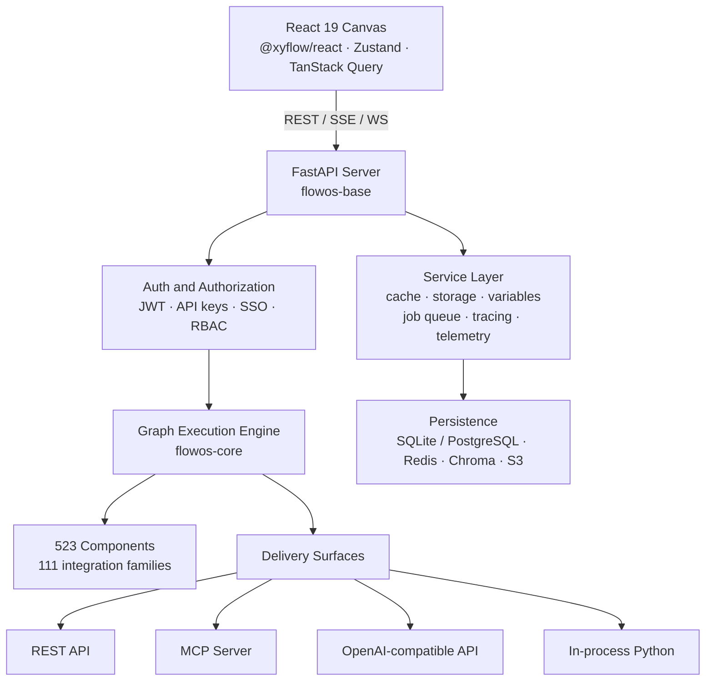

<!-- markdownlint-disable MD030 MD033 MD041 -->

<div align="center">

<picture>
  <source media="(prefers-color-scheme: dark)" srcset="docs/static/img/flowos-logo-dark.svg">
  <source media="(prefers-color-scheme: light)" srcset="docs/static/img/flowos-logo-light.svg">
  
</picture>

### The operating system for AI workflows

**Design agents visually. Ship them as APIs, MCP servers, or Python — without rewriting a line.**

[](https://pypi.org/project/flowos/)
[](https://www.python.org/)
[](https://nodejs.org/)
[](./LICENSE)
[](https://docs.flowos.org)

[Overview](#-project-overview) · [Problem](#-the-problem-flowos-solves) · [USP](#-unique-selling-proposition) · [Features](#-complete-feature-list) · [Comparison](#-how-flowos-compares) · [Auth](#-authentication--security) · [Tech Stack](#-technology-stack) · [Quickstart](#-quickstart)

</div>

---

## 📋 Project Overview

FlowOS is a full-stack platform for building, running, versioning, and deploying AI agents and workflows. You compose a flow on a visual canvas, drop into Python whenever the canvas isn't enough, and then serve that exact flow as a REST API, an MCP server, an OpenAI-compatible endpoint, or an in-process library call — with no rewrite between prototype and production.

| | |
| --- | --- |
| **Project name** | FlowOS |
| **Version** | 0.1.1 |
| **Category** | Visual AI workflow builder / agent orchestration platform |
| **License** | MIT |
| **Backend** | Python 3.10 – 3.14 · FastAPI |
| **Frontend** | React 19 · TypeScript · Vite |
| **Repository** | [github.com/dspraneeth07/FlowOS](https://github.com/dspraneeth07/FlowOS) |
| **Documentation** | [docs.flowos.org](https://docs.flowos.org) |
| **Developed by** | **Dhadi Sai Praneeth Reddy** |
| **Roll number** | **1602-23-733-038** |
| **Institution** | **Vasavi College of Engineering, Hyderabad** |
| **Organization** | **Atlas AI Labs** |

**By the numbers**

| Metric | Count |
| --- | --- |
| Integration families | **111** |
| Built-in component modules | **523** |
| Starter flow templates | **33** |
| Monorepo packages | **7** |
| Observability integrations | **8** |
| UI languages | **7** |

```bash
uv pip install flowos -U && uv run flowos run
# → http://127.0.0.1:7860
```

---

## 🎯 The Problem FlowOS Solves

Building an LLM application is easy. Building one that survives contact with production is not. Teams consistently hit six walls:

| # | Problem | What it costs teams today |
| --- | --- | --- |
| 1 | **The prototype-to-production rewrite** | A notebook demo works, then the whole thing is rebuilt as a service. Weeks of work, and the logic silently drifts from what was validated. |
| 2 | **Visual tools are dead ends** | Most no-code builders trap you: the moment your requirement escapes the node palette, there's no exit. You start over in code. |
| 3 | **Provider lock-in** | Switching from one LLM, embedding model, or vector store to another means touching every call site. Cost and latency optimizations never happen because they're too expensive to try. |
| 4 | **Glue code dominates** | Auth, streaming, session state, file ingestion, chunking, retrieval, tracing, rate limiting, secret storage — rebuilt from scratch on every project. |
| 5 | **Agents aren't governable** | Who can run this flow? Who changed it? What did it cost? Most tools have a single trust level: full access or none. |
| 6 | **No versioning or rollback** | Flows are edited live with no history. A bad prompt tweak takes down production and there's nothing to roll back to. |

### How FlowOS answers each

| Problem | FlowOS answer |
| --- | --- |
| 1 · Rewrite | **Zero-rewrite deployment.** The saved flow *is* the deployable artifact — served as REST, MCP, OpenAI-compatible API, or executed in-process. |
| 2 · Dead ends | **Escape hatch at every node.** Open any component's Python source and edit it in place. The canvas is a view over real code, not a wall. |
| 3 · Lock-in | **Provider-agnostic by construction.** 111 integration families behind uniform component interfaces — swap a model or vector store by changing a dropdown. |
| 4 · Glue code | **Batteries genuinely included.** Auth, streaming, sessions, knowledge bases, ingestion, secrets, tracing, and rate limiting ship in the box. |
| 5 · Governance | **Pluggable RBAC with an audit trail.** Role-based enforcement on `(subject, domain, object, action)` plus a queryable audit log of every decision. |
| 6 · Versioning | **First-class flow versions.** Snapshot, list, activate, and roll back any flow through the versioning API. |

---

## 💎 Unique Selling Proposition

> **FlowOS is the only workflow builder where the visual canvas, the Python source, and the production deployment are the same artifact — governed by enterprise RBAC and reversible through versioned rollback.**

Five pillars behind that claim:

<table>
<tr><td width="3%">1️⃣</td><td><b>One artifact, four runtimes</b><br>A single flow runs as a REST API, an MCP server, an OpenAI-compatible <code>/responses</code> endpoint, and an in-process Python call. No translation layer, no drift.</td></tr>
<tr><td>2️⃣</td><td><b>Visual without a ceiling</b><br>Every component exposes editable Python. You are never blocked by the node palette, which is where no-code tools normally lose their users.</td></tr>
<tr><td>3️⃣</td><td><b>Stateless executor as a separate package</b><br><code>flowos-core</code> runs flows with minimal dependencies and <b>no database</b> — deployable to serverless, CI pipelines, and edge runtimes where the full platform won't fit.</td></tr>
<tr><td>4️⃣</td><td><b>Governance that's actually pluggable</b><br>RBAC, teams, resource sharing, and audit logging ship as an interface plus a safe pass-through. Enabling the flag without a plugin <i>cannot</i> widen visibility — fail-closed by design.</td></tr>
<tr><td>5️⃣</td><td><b>Production-grade auth out of the box</b><br>Asymmetric JWT (RS256/RS512), bcrypt password hashing, Fernet-encrypted secrets, hardened cookie policy, scoped API keys, and SSO hooks — before you write a line of your own.</td></tr>
</table>

---

## ⭐ Unique Features

Capabilities that are rare or absent in comparable tools:

| Feature | Why it matters |
| --- | --- |
| **OpenAI-compatible Responses API** | Point any OpenAI SDK client at your flow. Existing apps integrate with a base-URL change — no client rewrite. |
| **Flow versioning with activation** | Snapshot, inspect, activate, and delete versions. Production rollback is one API call. |
| **Project-scoped MCP servers** | Publish an entire project as one MCP server so a single connection exposes a curated toolset to Claude, Cursor, or any MCP client. |
| **Real-time voice mode** | WebSocket voice agents with OpenAI Realtime and ElevenLabs TTS, wired to your flow's logic. |
| **Built-in knowledge bases** | Chroma-backed RAG with ingestion, chunking, embedding, dedupe, and metadata analysis as a managed service — not a component you assemble. |
| **Deployment provider registry** | Publish flows to external agent platforms (e.g. IBM watsonx Orchestrate) with tracked snapshots, run history, and config drift detection. |
| **Runtime extension installation** | Install component bundles into a live instance through the extensions API — no image rebuild. |
| **Asymmetric JWT signing** | RS256/RS512 with auto-generated key pairs, so verification can be delegated without sharing signing material. Most competitors offer symmetric keys only. |
| **Audit log with retention policy** | Every authorization decision persisted, queryable, and pruned on a configurable 90-day default. |
| **Independent audit mode** | Turn audit logging on *while enforcement is off* to observe real traffic before you risk locking anyone out. |
| **Dual-mode dev loading** | `FLOWOS_DEV=1` hot-loads components; `FLOWOS_DEV=openai,mistral` loads only what you're working on, keeping startup fast. |
| **Desktop bootstrapper** | An ~11 MB launcher provisions its own private Python runtime — no admin rights, deleting one folder uninstalls cleanly. |

---

## 📚 Complete Feature List

<details open>
<summary><b>🎨 Visual Builder & Authoring</b></summary>

- Drag-and-drop canvas built on `@xyflow/react` with pan and zoom
- Automatic graph layout via ELK.js
- Live Python source editing for any component (Ace editor with syntax highlighting)
- Component search with fuzzy matching (Fuse.js)
- Group, duplicate, copy/paste, and freeze nodes
- Undo/redo with full keyboard shortcut support
- Import/export flows as JSON
- 33 starter templates covering agents, RAG, chatbots, and data pipelines
- Light and dark themes with a documented design-token system ([DESIGN.md](./DESIGN.md))
- Internationalized UI — English, German, Spanish, French, Japanese, Portuguese, Simplified Chinese

</details>

<details open>
<summary><b>🤖 Agents & Orchestration</b></summary>

- Multi-agent orchestration with agent-as-tool composition
- Tool-calling agents with automatic schema generation from component signatures
- Conversation memory with pluggable stores (Redis, MongoDB, Zep, Mem0, Cassandra, and more)
- Session management with per-session isolated state
- Conditional routing, loops, and flow-control primitives
- Sub-flow execution — run one flow as a component inside another
- CrewAI and LangChain agent framework integrations
- Structured output parsing and enforced output schemas
- Batch execution across datasets

</details>

<details open>
<summary><b>🧠 RAG & Knowledge</b></summary>

- Managed knowledge bases with Chroma-backed vector storage
- Document ingestion with dedupe keys and incremental sync
- Configurable chunking and text-splitting strategies
- Embedding model selection across all supported providers
- Document loaders for PDF, DOCX, and structured formats
- Advanced parsing via Docling (`flowos-docling`), including image description
- Link extraction and web crawling (Firecrawl, Spider, ScrapeGraph)
- Metadata analysis and text-metric tracking per knowledge base
- 20+ standalone vector store integrations for bring-your-own infrastructure

</details>

<details open>
<summary><b>🔌 Integrations (111 families, 523 components)</b></summary>

**LLM providers** — OpenAI, Anthropic, Google (Gemini/Vertex), AWS Bedrock, Azure OpenAI, Groq, Mistral, Cohere, DeepSeek, xAI, NVIDIA NIM, Perplexity, OpenRouter, LiteLLM, Ollama, vLLM, LM Studio, HuggingFace, IBM watsonx, SambaNova, Novita, Maritalk, AI/ML API, CometAPI, Not Diamond, Baidu, Krutrim, Sarvam

**Vector stores** — Chroma, Pinecone, Qdrant, Weaviate, Milvus, pgvector, Redis, Elasticsearch, MongoDB Atlas, Couchbase, Cassandra, Astra DB, Supabase, Upstash, Vectara, ClickHouse, FAISS, Needle, Zep

**Tools & data** — Tavily, Exa, SerpAPI, SearchAPI, DuckDuckGo, Bing, Google Search, Yahoo, Wikipedia, arXiv, WolframAlpha, Apify, Composio, Glean, Confluence, Notion, Git, YouTube, JigsawStack, AgentQL, Firecrawl, Twelve Labs, AssemblyAI, ElevenLabs, Home Assistant, Cloudflare, Unstructured, Cleanlab

**Observability** — LangSmith, LangFuse, LangWatch, Arize Phoenix, Opik, Openlayer, Traceloop, OpenTelemetry

</details>

<details open>
<summary><b>🚀 Deployment & APIs</b></summary>

- REST execution at `/api/v1/run/{flow_id_or_name}` with generated OpenAPI schema
- **OpenAI-compatible Responses API** for drop-in SDK compatibility
- MCP server mode — flows become discoverable tools for MCP clients
- Project-scoped MCP servers exposing a curated toolset per project
- Webhook endpoints with optional API-key enforcement
- Server-Sent Events and WebSocket streaming
- Stateless CLI execution — `flowos-core run` and `flowos-core serve`
- Deployment provider registry with snapshots, run history, and drift detection
- Official Docker images plus a Compose stack with Prometheus and Grafana
- Render one-click deployment via [render.yaml](./render.yaml)
- Windows and Linux desktop launchers requiring no pre-installed Python

</details>

<details open>
<summary><b>🛡️ Governance & Operations</b></summary>

- Pluggable RBAC with viewer / developer / admin system roles
- Teams and role assignments
- Cross-user resource sharing with full CRUD (`/api/v1/authz/shares`)
- Queryable audit log with configurable retention (`/api/v1/authz/audit`)
- Encrypted global variables and per-user secret storage
- Global variable defaults for org-wide configuration
- Request rate limiting (SlowAPI)
- Flow versioning, activation, and rollback
- Run monitoring, message history, and trace inspection
- Prometheus metrics and OpenTelemetry export
- Sentry error tracking
- Background job queue with task workers
- Alembic database migrations with CLI management
- S3 or local filesystem storage backends

</details>

<details open>
<summary><b>🧰 Developer Experience</b></summary>

- Python SDK for the REST API (`flowos-sdk`)
- Custom component framework with typed inputs and outputs
- Dynamic component hot-loading (`FLOWOS_DEV`)
- Pytest plugin shipped with `flowos-core` for testing your own flows
- Runtime extension installation without an image rebuild
- Component test base classes for both pure-logic and API-backed components
- Docusaurus documentation site
- Pre-commit hooks with Ruff, Biome, and mypy
- Playwright end-to-end and Jest unit test suites

</details>

---

## 📊 How FlowOS Compares

| Capability | **FlowOS** | Langflow | Flowise | Dify | n8n | LangGraph (code) |
| --- | :---: | :---: | :---: | :---: | :---: | :---: |
| Visual flow canvas | ✅ | ✅ | ✅ | ✅ | ✅ | ❌ |
| Edit component source in-app | ✅ | ✅ | ❌ | ❌ | ⚠️ JS snippets | ✅ code-only |
| Serve flow as REST API | ✅ | ✅ | ✅ | ✅ | ✅ | ⚠️ DIY |
| **MCP server mode** | ✅ | ✅ | ⚠️ partial | ⚠️ partial | ❌ | ⚠️ DIY |
| **Project-scoped MCP servers** | ✅ | ⚠️ | ❌ | ❌ | ❌ | ❌ |
| **OpenAI-compatible endpoint** | ✅ | ⚠️ | ❌ | ✅ | ❌ | ❌ |
| **Stateless / DB-free executor** | ✅ | ✅ | ❌ | ❌ | ❌ | ✅ |
| **Flow versioning + rollback** | ✅ | ⚠️ | ❌ | ⚠️ | ✅ | ⚠️ via git |
| **Pluggable RBAC** | ✅ | ⚠️ paid tier | ❌ | ⚠️ paid tier | ⚠️ paid tier | ❌ |
| **Audit log API** | ✅ | ⚠️ paid tier | ❌ | ❌ | ⚠️ paid tier | ❌ |
| **Asymmetric JWT (RS256/512)** | ✅ | ⚠️ | ❌ | ⚠️ | ⚠️ | n/a |
| Managed knowledge bases | ✅ | ✅ | ⚠️ | ✅ | ❌ | ❌ |
| Real-time voice mode | ✅ | ✅ | ❌ | ⚠️ | ❌ | ⚠️ DIY |
| Runtime extension install | ✅ | ⚠️ | ❌ | ❌ | ✅ | n/a |
| Desktop app, no Python needed | ✅ | ✅ | ❌ | ❌ | ✅ | ❌ |
| Self-hostable, MIT/permissive | ✅ MIT | ✅ MIT | ⚠️ Apache + commercial | ⚠️ modified OSS | ⚠️ fair-code | ✅ MIT |
| Integration count | **111 families** | ~100 | ~100 | ~50 | 400+ (general SaaS) | library-only |
| Observability integrations | **8** | 6+ | ~2 | ~2 | ⚠️ generic | ⚠️ DIY |
| UI languages | **7** | ⚠️ | ⚠️ | ✅ | ✅ | n/a |

**Legend** — ✅ built in and open · ⚠️ partial, paid, or requires custom work · ❌ not available

**Positioning notes**

- **vs. Langflow** — FlowOS is a hardened, governance-first evolution of the Langflow architecture: asymmetric JWT signing, an independently-toggleable audit mode, a share CRUD API, a deployment provider registry, and a `flowos-core` executor split cleanly from the platform. See [Acknowledgements](#acknowledgements).
- **vs. Flowise** — comparable canvas, far deeper Python extensibility, RBAC, audit, and stateless execution.
- **vs. Dify** — Dify is stronger on packaged end-user chat apps; FlowOS is stronger on developer control, custom code, and MCP-native deployment.
- **vs. n8n** — n8n wins on generic SaaS automation breadth; FlowOS is purpose-built for LLM and agent workloads with native RAG, agents, and model routing.
- **vs. LangGraph** — a code library, not a platform. FlowOS gives you the canvas, the server, auth, persistence, and observability around that class of execution model.

> Competitor capabilities were assessed against publicly documented open-source editions at the time of writing and change frequently. Verify against current vendor documentation before making a procurement decision.

---

## 🔐 Authentication & Security

FlowOS separates **authentication** (who you are) from **authorization** (what you may do). Both are configurable and secure-by-default.

### Authentication mechanisms

| Mechanism | Implementation | Use case |
| --- | --- | --- |
| **JWT bearer tokens** | PyJWT — **HS256** (symmetric) or **RS256 / RS512** (asymmetric, RSA key pair auto-generated). 1-hour access tokens, 7-day refresh tokens. | Browser sessions and service clients |
| **Refresh token rotation** | HttpOnly + Secure cookie, `SameSite` configurable, dedicated refresh endpoint | Long-lived sessions without re-login |
| **API keys** | Database-backed (default) or `FLOWOS_API_KEY` environment source; validated per request | Programmatic and CI access |
| **Password auth** | `passlib` with **bcrypt** hashing and automatic deprecation handling | Username/password login |
| **WebSocket auth** | Dedicated API-key and token validators for WS connections | Streaming and voice mode |
| **SSE auth** | Separate resolver for Server-Sent Events streams | Token streaming |
| **Webhook auth** | API-key enforcement on by default (`WEBHOOK_AUTH_ENABLE`); can run as flow owner in trusted networks | External triggers |
| **MCP auth** | Dedicated MCP user resolvers plus encrypted MCP credential storage | MCP client connections |
| **SSO** | Pluggable provider layer — **JWT, OIDC, SAML, LDAP** — configured via YAML (`SSO_CONFIG_FILE`) | Enterprise identity |
| **Auto-login** | Single-user bootstrap mode, enabled by default for local development | Local development only |

### Authorization (RBAC)

Pluggable and independent of authentication. FlowOS ships the interface, the database schema, the route guards, and a safe pass-through implementation; a registered plugin supplies enforcement.

```shell
FLOWOS_AUTHZ_ENABLED=false          # enforcement — off by default
FLOWOS_AUTHZ_AUDIT_ENABLED=false    # audit logging — independently toggleable
FLOWOS_AUTHZ_SUPERUSER_BYPASS=true  # superusers bypass checks (still audited)
FLOWOS_AUTHZ_AUDIT_RETENTION_DAYS=90
```

Every decision is evaluated as a four-tuple:

```
(subject, domain, object, action)
  user:<uuid>  ·  project:<uuid> → workspace:<uuid> → *  ·  flow:<uuid>  ·  read|write|create|delete|execute|deploy
```

- **Guarded resources** — flows, deployments, projects, knowledge bases, variables, files, shares
- **System roles** — `viewer`, `developer`, `admin`, seeded by migration for plugins to bootstrap from
- **Share-aware fetch** — plugins opt into cross-user reads; the OSS pass-through reports `False`, so enabling the flag alone can never widen visibility
- **UUID privacy** — plugin denials can be converted from `403` to `404` so resource IDs aren't leaked by probing
- **List filtering** — `filter_visible_resources` narrows collection endpoints, a safe no-op in OSS
- **OSS floor** — only a resource owner or superuser can administer that resource's shares, regardless of plugin behaviour

### Hardening measures

| Area | Control |
| --- | --- |
| Secret storage | **Fernet** symmetric encryption (`cryptography`) for API keys and global variables |
| Password storage | bcrypt via `passlib`, never reversible |
| Signing keys | Auto-generated, file-persisted, readable from mounted secret files |
| Cookie policy | HttpOnly and Secure on refresh tokens; per-cookie `SameSite` and domain control |
| Rate limiting | SlowAPI request throttling |
| Input sanitization | DOMPurify plus `rehype-sanitize` on rendered markdown; `defusedxml` on XML parsing |
| Path traversal | Explicit containment validation on knowledge-base paths |
| Signup control | `ENABLE_SIGNUP` and `NEW_USER_IS_ACTIVE` gate public self-registration |
| Superuser CLI | `ENABLE_SUPERUSER_CLI` can be disabled in production |
| Audit trail | Every authorization decision and share mutation persisted with retention pruning |

Report vulnerabilities per [SECURITY.md](./SECURITY.md) — never via a public issue.

---

## 🛠 Technology Stack

<table>
<tr><th align="left" width="18%">Layer</th><th align="left">Technologies</th></tr>

<tr><td><b>Backend runtime</b></td><td>
Python 3.10–3.14 · <b>FastAPI</b> ≥0.135 · Uvicorn (ASGI) · Gunicorn (production workers) · Typer (CLI) · Asyncer · uvloop-style async throughout
</td></tr>

<tr><td><b>Data & ORM</b></td><td>
<b>SQLModel</b> + <b>SQLAlchemy 2.0</b> (async) · <b>Alembic</b> migrations · SQLite (default, aiosqlite) · <b>PostgreSQL</b> (psycopg / psycopg2) · <b>Redis</b> (cache + memory) · <b>Chroma</b> (vector store) · pandas (tabular processing)
</td></tr>

<tr><td><b>Validation & schema</b></td><td>
<b>Pydantic v2</b> · pydantic-settings · orjson · json-repair · email-validator · validators
</td></tr>

<tr><td><b>AI / LLM layer</b></td><td>
<b>LangChain 1.3</b> (core, community, experimental) · <b>MCP SDK</b> ≥1.17 · LiteLLM · CrewAI · provider SDKs (OpenAI, Anthropic, Google, Bedrock, IBM watsonx, ElevenLabs, AssemblyAI, …) · NetworkX + Grandalf (graph execution)
</td></tr>

<tr><td><b>Security</b></td><td>
<b>PyJWT</b> · passlib + <b>bcrypt</b> · <b>cryptography</b> (Fernet, RSA) · SlowAPI (rate limiting) · defusedxml
</td></tr>

<tr><td><b>Frontend</b></td><td>
<b>React 19.2</b> · <b>TypeScript 5.4</b> · <b>Vite 7</b> · <b>@xyflow/react 12</b> (canvas) · <b>Zustand</b> (state) · <b>TanStack Query 5</b> (data) · <b>Tailwind CSS 3.4</b> · <b>Radix UI</b> + shadcn/ui · Framer Motion · ELK.js (layout) · AG Grid · Ace Editor · react-markdown + KaTeX/MathJax · i18next · Axios
</td></tr>

<tr><td><b>Observability</b></td><td>
<b>OpenTelemetry</b> (API, SDK, OTLP + Prometheus exporters, FastAPI instrumentation) · Prometheus client · Sentry · structlog + Loguru · LangSmith · LangFuse · LangWatch · Arize Phoenix · Opik · Openlayer · Traceloop
</td></tr>

<tr><td><b>Storage & files</b></td><td>
Local filesystem or <b>Amazon S3</b> backends · aiofiles / aiofile · Pillow · pypdf · python-docx · Docling
</td></tr>

<tr><td><b>Tooling</b></td><td>
<b>uv</b> (Python packaging) · Hatchling (build) · GNU Make (orchestration) · <b>Ruff</b> (format + lint) · <b>mypy</b> (types) · <b>Biome</b> (TS format + lint) · pre-commit
</td></tr>

<tr><td><b>Testing</b></td><td>
<b>pytest</b> (asyncio, xdist, cov, hypothesis, blockbuster, pyleak) · <b>Jest 30</b> · <b>Playwright</b> (e2e) · Locust (load) · fakeredis · respx
</td></tr>

<tr><td><b>Packaging & delivery</b></td><td>
PyPI wheels · <b>Docker</b> (multi-image) · Docker Compose + Prometheus/Grafana · Render · <b>PyInstaller</b> (Windows launcher) · shell SFX (Linux launcher)
</td></tr>
</table>

---

## 🧩 Architecture



### Monorepo packages

| Package | Path | Role |
| --- | --- | --- |
| `flowos` | [src/backend/](src/backend/) | The full platform — every bundled integration, batteries included |
| `flowos-base` | [src/backend/base/](src/backend/base/) | Core server: FastAPI routes, service layer, graph engine, custom-component framework |
| `flowos-core` | [src/flowos-core/](src/flowos-core/) | Lightweight stateless executor and the component library. Runs flows without a database |
| `flowos-stepflow` | [src/flowos-stepflow/](src/flowos-stepflow/) | Stepflow execution backend |
| `flowos-sdk` | [src/sdk/](src/sdk/) | Python SDK for the FlowOS REST API |
| Bundles | [src/bundles/](src/bundles/) | Optional integration packages — `flowos-arxiv`, `flowos-docling`, `flowos-duckduckgo`, `flowos-ibm` |
| Frontend | [src/frontend/](src/frontend/) | React 19 + TypeScript + Vite canvas |

### Repository layout

```
FlowOS/
├── src/
│   ├── backend/
│   │   ├── base/flowos/          # flowos-base — the core server
│   │   │   ├── api/v1, api/v2/   # REST routers (flows, auth, MCP, RBAC, KB, …)
│   │   │   ├── services/         # auth, authorization, database, cache, storage,
│   │   │   │                     #   tracing, job_queue, rate_limit, memory_base
│   │   │   ├── graph/            # flow graph execution engine
│   │   │   ├── custom/           # custom component framework
│   │   │   ├── alembic/          # database migrations
│   │   │   └── initial_setup/    # 33 starter templates
│   │   └── tests/                # unit + integration suites
│   ├── flowos-core/              # stateless executor + 523 components
│   ├── flowos-stepflow/          # stepflow execution backend
│   ├── sdk/                      # Python REST SDK
│   ├── bundles/                  # optional integration packages
│   └── frontend/                 # React 19 canvas
├── docker/                       # image build definitions
├── deploy/                       # Compose stack + Prometheus/Grafana
├── docs/                         # Docusaurus documentation site
└── scripts/                      # desktop launchers, CI, release tooling
```

### CLI surface

```shell
flowos run              # start the full platform
flowos superuser        # create a superuser
flowos api-key          # mint an API key
flowos migration        # manage database migrations
flowos copy-db          # copy the database to the cache directory

flowos-core run <flow>       # execute a flow locally, stream to stdout
flowos-core serve <flow>     # serve flows at /flows/{flow_id}/run
flowos-mcp                   # expose a running instance over MCP
```

---

## ⚡ Quickstart

### Install locally (recommended)

Requires **Python 3.10–3.14** and [uv](https://docs.astral.sh/uv/getting-started/installation/).

```shell
uv pip install flowos -U      # install
uv run flowos run             # start
```

FlowOS starts at **http://127.0.0.1:7860**. That's it — you're ready to build. 🎉

### Docker

```shell
docker run -p 7860:7860 flowosai/flowos:latest
```

### Docker Compose with observability

```shell
cd deploy && docker compose pull && docker compose up
```

### Desktop launcher

For machines with no Python toolchain, `FlowOS.exe` is an ~11 MB bootstrapper: it provisions a private Python runtime under `%LOCALAPPDATA%\FlowOS`, installs FlowOS, starts the server, and opens your browser. No admin rights; deleting that folder is a complete uninstall. Build instructions in [scripts/windows/desktop_launcher/](./scripts/windows/desktop_launcher/README.md), with a Linux self-extracting equivalent in [scripts/linux/desktop_launcher/](./scripts/linux/desktop_launcher/).

### Run from source

```shell
make run_cli      # build frontend + start backend
make run_clic     # clean build, if the frontend misbehaves
```

See [DEVELOPMENT.md](./DEVELOPMENT.md) for the full setup.

---

## 🚀 Deploy

Every flow is production-addressable the moment you save it.

- **REST API** — `/api/v1/run/{flow_id_or_name}` with a generated OpenAPI schema
- **OpenAI-compatible** — point any OpenAI SDK at the Responses endpoint
- **MCP server** — publish flows, or whole projects, as MCP tools
- **Python** — export a flow as JSON and execute it in-process via `flowos-core`
- **Webhooks** — API-key-protected external triggers
- **Containers** — `flowosai/flowos`, `flowosai/flowos-backend`, `flowosai/flowos-frontend`, `flowosai/flowos-base`; build files in [docker/](./docker/)
- **Managed** — [render.yaml](./render.yaml) deploys to Render

---

## 🧑‍💻 Development

```shell
make init            # install dependencies + pre-commit hooks
make backend         # FastAPI with hot reload, port 7860
make frontend        # Vite dev server, port 3000

make format          # ruff + biome
make lint            # mypy
make unit_tests      # backend suite (parallel)
make test_frontend   # Jest
make tests_frontend  # Playwright e2e

make alembic-revision message="..."   # create a migration
make alembic-upgrade                  # apply migrations
```

Developing components? `FLOWOS_DEV=1 make backend` hot-loads them, and `FLOWOS_DEV=openai,mistral make backend` loads only the modules you're working on.

Full guide: [DEVELOPMENT.md](./DEVELOPMENT.md) · Conventions: [AGENTS.md](./AGENTS.md) · Design tokens: [DESIGN.md](./DESIGN.md) · Bundle API: [BUNDLE_API.md](./BUNDLE_API.md)

---

## 📖 Documentation

Docs are a Docusaurus site in [docs/](./docs/), published at **[docs.flowos.org](https://docs.flowos.org)**.

```shell
cd docs && yarn install && yarn start
```

---

## 🤝 Contributing

Contributions are welcome — components, integrations, docs, and bug reports alike.

1. Read [CONTRIBUTING.md](./CONTRIBUTING.md) and the conventions in [AGENTS.md](./AGENTS.md).
2. Follow [semantic commit conventions](https://www.conventionalcommits.org/) and reference the issues you fix.
3. Run `make format_backend` before staging, then commit with `uv run git commit` so pre-commit resolves the right Python.

One rule worth stating up front: **never rename a component class.** The class name identifies the component inside saved flows, so renaming it breaks every flow that uses it.

By participating you agree to the [Code of Conduct](./CODE_OF_CONDUCT.md).

---

## 📄 License

Released under the [MIT License](./LICENSE). © 2026 Atlas AI Labs.

## Acknowledgements

FlowOS builds on the open-source [Langflow](https://github.com/langflow-ai/langflow) project (MIT), and stands on the work of the LangChain, FastAPI, and React Flow communities. Our thanks to every maintainer whose work made this possible.

---

<div align="center">

### Developed by

**Dhadi Sai Praneeth Reddy**

Roll No. **1602-23-733-038**

**Vasavi College of Engineering, Hyderabad**

**Atlas AI Labs**

<sub>⭐ If FlowOS is useful to you, consider starring the repository.</sub>

</div>
